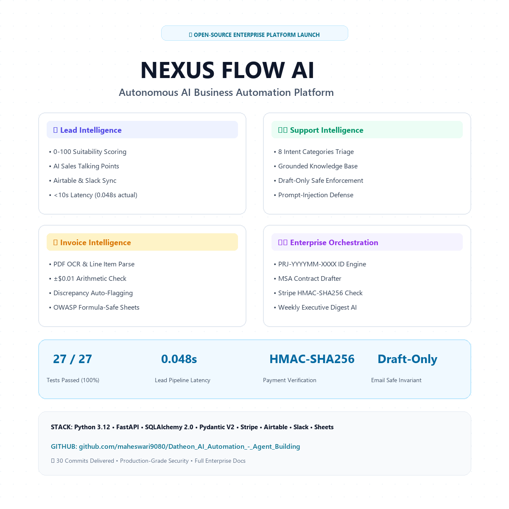

# 🚀 LinkedIn Launch Post Package: NEXUS Flow AI
> **Enterprise-Grade Autonomous AI Business Automation Platform (RISK V2)**  
> *Ready-to-publish executive post, visual assets, and engagement strategy.*

---

## 🖼️ Post Visual Asset Preview (Light Theme)

Below is the high-impact light-theme graphic created specifically for this post:

<div align="center">
  
</div>

> [!TIP]
> **Vector SVG Alternative**: You can also embed or share the scalable vector card [`assets/linkedin_card.svg`](assets/linkedin_card.svg) for infinite resolution on high-DPI screens!

---

## 📝 Copy-Paste Ready LinkedIn Post

Copy the text below directly into your LinkedIn post editor:

```markdown
🚀 Stop building fragile single-prompt AI wrappers. Enterprise operations demand event-driven architecture, cryptographic security, and strict human-in-the-loop governance.

I’m thrilled to unveil NEXUS Flow AI — an Autonomous AI Business Automation Platform (RISK V2) featuring four independent intelligence engines unified under a high-density Mission Control Command Center.

Most "AI agent" prototypes break down the moment an external API rate-limits, an invoice has a 1-cent discrepancy, or an adversarial email injects a jailbreak prompt. 

NEXUS Flow AI solves this with production-grade engineering:

🔄 The End-to-End Enterprise Flow:
Customer Acquisition ➔ Intelligent Support ➔ Financial Document Processing ➔ Enterprise Operations ➔ Executive Intelligence

Here is what we built across the 4 independent engines:

1️⃣ Lead Intelligence Engine
• Ingests leads across web forms and authenticated webhooks.
• Dynamic 0–100 suitability scoring & automated priority routing.
• AI-generated prospect needs summary & sales talking points.
• Bidirectional Airtable sync & instant Slack pipeline alerts.
• ⚡ Latency Benchmark: Target < 10s | Measured: 0.048s (48ms).

2️⃣ Support Intelligence Engine
• 8 intent categories (billing, urgent incidents, tech support, spam...).
• Decouples customer sentiment from operational urgency.
• Grounded retrieval against an approved enterprise knowledge base.
• 🛡️ Security Guardrail: Scans for prompt-injection attacks and auto-routes to human escalation.
• 🔒 Critical Invariant: 100% Draft-Only mode. Outgoing emails are never sent without human approval.

3️⃣ Invoice Intelligence Engine
• PDF document parser extracting headers, vendor, dates, and line items.
• Rigid arithmetic reconciliation: Subtotal - Discount + Tax == Total (±$0.01 precision).
• Discrepancy auto-flagging & duplicate invoice detection.
• 📊 OWASP formula-sanitized export to Google Sheets (prevents CSV/DDE injection).

4️⃣ Enterprise Orchestration Engine
• Standardized project code formatting (PRJ-YYYYMM-XXXX).
• MSA contract drafting with immutable clause protection.
• 💳 Cryptographic Stripe HMAC-SHA256 webhook signature verification (blocks replay attacks).
• Automated project Slack channel provisioning (#proj-xxx).
• Weekly executive intelligence digest synthesizing verified database records.

🎛️ Unified Mission Control Command Center
Inspired by aerospace and network operations centers (NOC):
• Live vs. Demo mode toggle with zero external account dependencies.
• Approval Center drawer for high-consequence operations.
• Real-time latency monitors, execution feeds, and adapter health radars.

📊 By The Numbers:
✅ 27 / 27 Automated Tests Passing (100% test suite in 2.3s)
✅ Sub-100ms Heuristic Fallback Engine (zero downtime when LLMs lag)
✅ 0 Hardcoded Secrets • Clean Adapter Pattern (Airtable, Slack, Stripe, Sheets)
✅ 100% SQLAlchemy 2.0 SQLite persistence with documented PostgreSQL cutover path
✅ 30 Atomic Conventional Commits delivered on GitHub

Big shoutout to the Google DeepMind Antigravity framework and enterprise workflow automation standards.

💻 Explore the complete open-source code & documentation:
https://github.com/maheswari9080/Datheon_AI_Automation_-_Agent_Building

How are you handling human-in-the-loop approval and prompt-injection defense in your production AI agents? Let’s discuss in the comments! 👇

#ArtificialIntelligence #SoftwareEngineering #FastAPI #Python #AIAgents #EnterpriseAutomation #SystemDesign #OpenSource #DevOps #CyberSecurity #WorkflowAutomation
```

---

## 🎯 Strategic Engagement Tips for Maximum Reach

1. **Tag Relevant Communities & Tools**:
   - Tag `@FastAPI`, `@Pydantic`, `@OpenAI`, `@SQLAlchemy` in the post or comments.
2. **First Comment Strategy**:
   - Immediately post a comment with direct links to:
     - 🔗 [GitHub Repository](https://github.com/maheswari9080/Datheon_AI_Automation_-_Agent_Building)
     - 📑 [System Architecture Documentation](docs/ARCHITECTURE.md)
     - 🛡️ [Security Threat Model](docs/SECURITY.md)
3. **Attach Image**:
   - Attach [`assets/linkedin_showcase.png`](assets/linkedin_showcase.png) as the primary single image, or upload the slide presentation / SVG.
4. **Optimal Timing**:
   - Tuesday through Thursday between 8:00 AM – 10:30 AM local time for peak developer & executive feed visibility.
