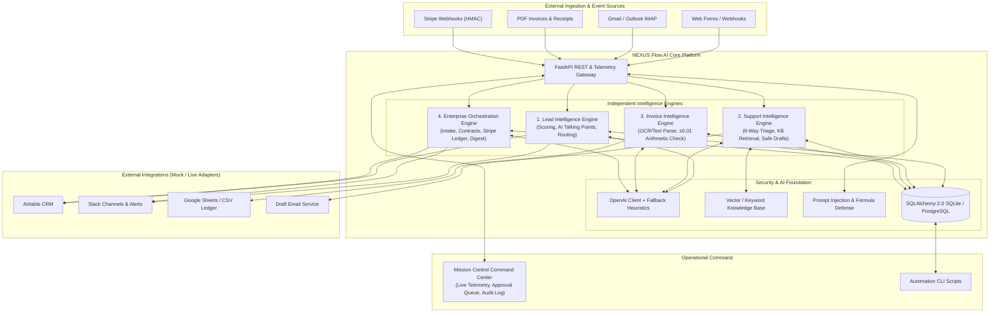

# NEXUS Flow AI — Intelligent Business Automation Hub
> **RISK V2 Autonomous AI Business Automation Platform**  
> *Four Independent Enterprise Engines + Unified Operational Command Center*

[](https://python.org)
[](https://fastapi.tiangolo.com)
[](https://sqlalchemy.org)
[](https://docs.pydantic.dev)
[]()
[]()

---

## 🌟 Executive Vision & Overview

**NEXUS Flow AI** is a production-grade, event-driven enterprise automation platform that orchestrates the entire operational lifecycle:

```
Customer Acquisition ➔ Intelligent Support ➔ Financial Document Processing ➔ Enterprise Operations ➔ Executive Intelligence
```

Unlike static admin templates or toy prototypes, **NEXUS Flow AI** delivers four fully functional, independently deployable micro-engines unified under a high-density, cyberpunk/mission-control Command Center. It features real workflow execution, structured AI schema validation, deterministic fallback intelligence, resilient external integration adapters (Airtable, Slack, Stripe, Google Sheets, Gmail/Outlook), and zero-compromise security governance.

---

## 🏗️ Architecture & Core Modules



### The 5 Operational Pillars

| Engine | Primary Workflow | Key Features & Safeguards |
| :--- | :--- | :--- |
| **1. Command Center** | Operational Telemetry & Control | Live/Demo mode toggle, real-time latency tracker, approval gateway, execution feed, integration health radar. |
| **2. Lead Intelligence** | Ingestion & Qualification | Multi-source ingestion, duplicate detection, budget suitability rules, AI talking-point generator, Airtable & Slack routing, sub-10s latency. |
| **3. Support Intelligence** | Email Triage & Safe Drafting | 8-way intent categorization, separate urgency/sentiment scoring, grounded KB retrieval, prompt-injection defense, **draft-only mode invariant**. |
| **4. Invoice Intelligence** | Financial Document Audit | PDF text/regex extraction, strict arithmetic reconciliation ($\pm 0.01$ precision), duplicate invoice detection, OWASP formula-sanitized Google Sheets export. |
| **5. Enterprise Orchestration** | End-to-End Business Delivery | Auto project codes (`PRJ-YYYYMM-XXXX`), legal contract drafting, **Stripe HMAC-SHA256 signature verification**, Slack project channel orchestration, weekly executive digests. |

---

## ⚡ Quickstart

### 1. Prerequisites
- Python 3.11+ (Python 3.12 recommended)
- `pip` package manager
- (Optional) Git, Docker, Make/n8n

### 2. Installation
```bash
# Clone repository
git clone https://github.com/maheswari9080/Datheon_AI_Automation_-_Agent_Building.git
cd Datheon_AI_Automation_-_Agent_Building

# Install dependencies
pip install -r requirements.txt

# Copy environment variables template
cp .env.example .env
```

### 3. Run Automated Tests
Execute the complete test suite across all engines, adapters, and CLI commands:
```bash
python -m pytest -v
```
*Expected: 27 passed, 100% test success rate.*

### 4. Launch the Command Center & API Server
```bash
python -m nexus_flow.main
```
- **Mission Control UI**: Open your browser at [http://127.0.0.1:8000](http://127.0.0.1:8000)
- **Interactive Swagger API Docs**: [http://127.0.0.1:8000/docs](http://127.0.0.1:8000/docs)
- **API Health Telemetry**: [http://127.0.0.1:8000/api/v1/health](http://127.0.0.1:8000/api/v1/health)

---

## 🛠️ Automation CLI Tools

NEXUS Flow AI includes a high-performance command-line utility for batch operations and pipeline automation:

```bash
# Display CLI help
python scripts/automation_cli.py --help

# Batch process leads from a CSV file
python scripts/automation_cli.py batch-leads --input sample_leads.csv

# Audit all uploaded invoices and flag arithmetic discrepancies
python scripts/automation_cli.py audit-invoices

# Export audit trail to a timestamped JSON file
python scripts/automation_cli.py export-audit --output audit_export.json

# Seed the local database with realistic enterprise demo data
python scripts/automation_cli.py seed-demo
```

---

## 🔒 Security & Reliability Guardrails

- **Zero Fabricated Accounts / Zero Leaked Secrets**: All integrations use secure adapter patterns with mock/live switches. Runs out of the box in **Demo Mode** without external account dependencies.
- **Stripe HMAC-SHA256 Signature Verification**: Cryptographic signature checks prevent replay attacks and fraudulent webhooks.
- **OWASP CSV/Formula Injection Defense**: All spreadsheet exports prefix risky triggers (`=`, `+`, `-`, `@`, `\t`, `\r`) with a single quote (`'`).
- **Prompt-Injection Sanitization**: Incoming support emails are scrubbed for instruction overrides, system token manipulation, and role impersonation attacks.
- **Draft-Only Email Policy**: Outgoing customer responses are created as drafts for human oversight.
- **Human Approval Gateway**: Refunds, contract issuance, and high-value operations enforce strict human sign-off.

---

## 📂 Project Structure

```
├── nexus_flow/                    # Core Application Package
│   ├── adapters/                  # External Service Adapters (Mock & Live)
│   │   ├── airtable.py            # Airtable CRM Adapter
│   │   ├── base.py                # Base Adapter Protocol
│   │   ├── email.py               # Gmail/Outlook Draft Adapter
│   │   ├── google_sheets.py       # Google Sheets / CSV Adapter
│   │   ├── slack.py               # Slack Webhook & Channel Adapter
│   │   └── stripe.py              # Stripe HMAC Webhook Adapter
│   ├── ai/                        # AI & Intelligence Infrastructure
│   │   ├── fallbacks.py           # Deterministic Heuristic Fallbacks
│   │   ├── knowledge_base.py      # Grounded Enterprise Knowledge Base
│   │   ├── openai_client.py       # OpenAI Client with Schema Enforcement
│   │   └── prompts.py             # Versioned System Prompt Templates
│   ├── core/                      # Application Kernel
│   │   ├── config.py              # Pydantic Settings & Mode Switches
│   │   ├── database.py            # SQLAlchemy 2.0 Engine & Sessions
│   │   ├── logging.py             # Structured JSON Telemetry Logger
│   │   └── security.py            # Cryptographic & Sanitization Utilities
│   ├── db/                        # Database Layer
│   │   ├── migrations.py          # Automatic Table Creation & Migrations
│   │   └── models.py              # Normalized ORM Entity Models
│   ├── engines/                   # 4 Independent Domain Engines
│   │   ├── invoice/               # Invoice Intelligence Engine
│   │   ├── lead/                  # Lead Intelligence Engine
│   │   ├── orchestration/         # Enterprise Orchestration Engine
│   │   └── support/               # Support Intelligence Engine
│   ├── schemas/                   # Pydantic v2 Contract Specifications
│   ├── ui/                        # Unified Mission Control Web App
│   │   ├── static/                # Vanilla CSS & JavaScript Control Center
│   │   └── templates/             # HTML Templates
│   └── main.py                    # FastAPI Application Entrypoint
├── docs/                          # Comprehensive Enterprise Documentation
│   ├── ARCHITECTURE.md            # Deep Technical Architecture & Data Flows
│   ├── CLIENT_ONBOARDING.md       # Implementation Playbook for Clients
│   ├── DEMO_SCENARIOS.md          # 10-Step Repeatable Walkthrough Guide
│   ├── INSTALLATION.md            # Detailed Multi-Platform Setup Guide
│   ├── INTEGRATION_SETUP.md       # External API Provisioning & Credentials
│   ├── SECURITY.md                # Threat Model & Cryptographic Verification
│   ├── TEST_PLAN.md               # Quality Assurance & Test Verification
│   └── VIDEO_WALKTHROUGH.md       # Demonstration Recording Script
├── scripts/                       # Workflow Automation CLI Scripts
│   └── automation_cli.py          # Unified CLI Utility
├── tests/                         # Pytest Automated Test Suite (27 tests)
│   ├── test_adapters.py           # Adapter Mock & Defense Tests
│   ├── test_api_endpoints.py      # REST Endpoint & Health Tests
│   ├── test_automation_cli.py     # CLI Execution Tests
│   ├── test_invoice_engine.py     # Arithmetic & PDF Validation Tests
│   ├── test_lead_engine.py        # Lead Scoring & Consent Tests
│   ├── test_orchestration_engine.py # Stripe, Intake & Digest Tests
│   └── test_support_engine.py     # Triage, Draft & Prompt-Injection Tests
├── workflows/                     # Visual Automation Blueprints
│   ├── make_invoice_pipeline.json # Importable Make.com Scenario
│   └── n8n_lead_triage.json       # Importable n8n Workflow Blueprint
├── requirements.txt               # Pinned Python Dependencies
└── README.md                      # Platform Documentation
```

---

## 📖 Complete Documentation Index

For in-depth guides, see the [docs/](docs/) directory:
- [Architecture Blueprint](docs/ARCHITECTURE.md)
- [Installation & Deployment](docs/INSTALLATION.md)
- [External Integration Setup](docs/INTEGRATION_SETUP.md)
- [Security & Threat Governance](docs/SECURITY.md)
- [Test Plan & Latency Benchmarks](docs/TEST_PLAN.md)
- [Repeatable Demonstration Walkthrough](docs/DEMO_SCENARIOS.md)
- [Enterprise Client Onboarding](docs/CLIENT_ONBOARDING.md)
- [Video Walkthrough Storyboard](docs/VIDEO_WALKTHROUGH.md)

---

## 📄 License & Intellectual Property
Developed for Enterprise Business Automation under the MIT License.
All rights reserved © 2026 NEXUS Flow AI Systems.
