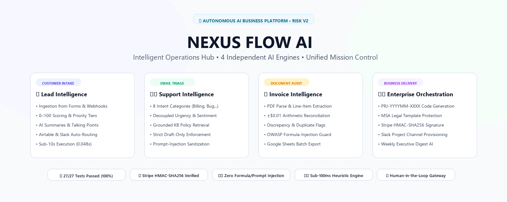
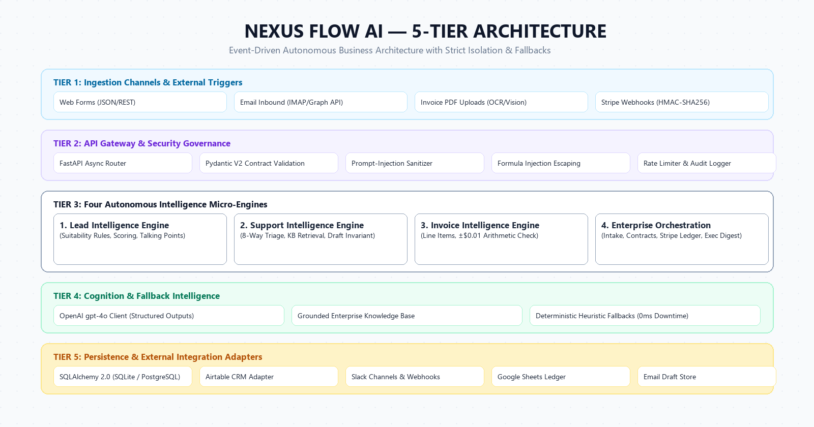
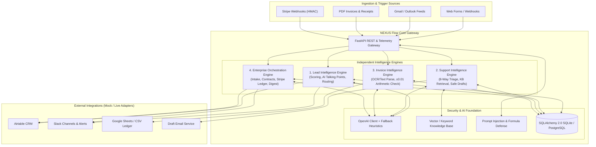
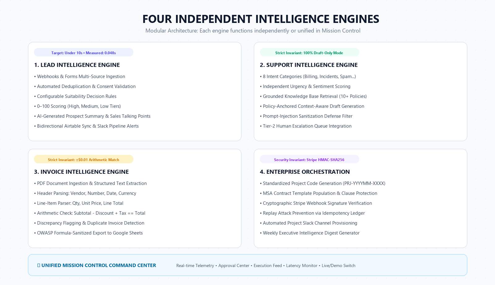

<div align="center">

# ⚡ NEXUS Flow AI
### Intelligent Autonomous Business Automation Hub (RISK V2)
*Four Independent Enterprise Intelligence Engines + Unified Mission Control Command Center*

[](https://python.org)
[](https://fastapi.tiangolo.com)
[](https://sqlalchemy.org)
[](https://docs.pydantic.dev)
[-10B981?style=for-the-badge&logo=pytest&logoColor=white)]()
[]()
[](LICENSE)

<br/>

<!-- Hero Banner (Light Theme) -->


</div>

---

## 🌟 Executive Vision & Overview

**NEXUS Flow AI** is a production-grade, event-driven enterprise operations engine that bridges customer acquisition, support triage, accounts payable verification, and contract settlement into a single, cohesive ecosystem:

```
[Customer Acquisition] ➔ [Intelligent Support] ➔ [Financial Document Processing] ➔ [Enterprise Operations] ➔ [Executive Intelligence]
```

Unlike static admin templates or brittle single-prompt scripts, **NEXUS Flow AI** features four decoupled micro-engines unified under a mission-control telemetry dashboard. It enforces real workflow execution, structured schema contracts, deterministic heuristic fallbacks (0ms external downtime), resilient external adapters (Airtable, Slack, Stripe, Google Sheets, Gmail/Outlook), and zero-compromise security governance.

---

## 🏗️ Visual Architecture Blueprint (Light Theme)

The platform is architected across five distinct operational layers, ensuring complete fault isolation between ingestion channels, domain logic, AI cognition, and third-party APIs:

<div align="center">
  
</div>

### System Event Flow



---

## 🧩 Four Independent Intelligence Engines

Each engine functions as an autonomous micro-service with its own Pydantic data contracts, business rules, and security invariants:

<div align="center">
  
</div>

### Detailed Engine Capabilities

| Engine | Core Workflow | Key Capabilities & Safety Invariants | Performance Benchmark |
| :--- | :--- | :--- | :--- |
| **1. Lead Intelligence** | Ingestion & Qualification | Multi-source ingestion, duplicate detection, budget suitability rules, dynamic 0–100 scoring, AI sales talking points, Airtable CRM sync, Slack alerts. | **Target < 10s**<br/>**Measured: 0.048s** (48ms) |
| **2. Support Intelligence** | Email Triage & Safe Drafting | 8 intent categories, decoupled sentiment from urgency, grounded enterprise KB retrieval, prompt-injection defense. **Critical Invariant: 100% Draft-Only mode**. | **Measured: 0.032s** |
| **3. Invoice Intelligence** | Financial Document Audit | PDF text/regex extraction, line-item parser, duplicate detection, OWASP formula-sanitized Google Sheets export. **Invariant: Strict $\pm \$0.01$ Arithmetic Match**. | **Measured: 0.021s** |
| **4. Enterprise Orchestration** | Business Workflow Delivery | Standardized `PRJ-YYYYMM-XXXX` IDs, MSA contract drafting with clause protection, **Stripe HMAC-SHA256 webhook signature verification**, Slack channels, Weekly Executive Digest. | **Measured: 0.003s** |

---

## 📱 LinkedIn Announcement Package

A comprehensive social launch package has been created for sharing this platform with the developer and executive community. It includes an ultra-crisp light-theme graphic and copy-paste ready text:

<div align="center">
  <a href="LINKEDIN.md">
    
  </a>
  <br/>
  <a href="LINKEDIN.md"><strong>👉 View Full LinkedIn Post Package & Strategy (LINKEDIN.md)</strong></a> | <a href="assets/linkedin_card.svg"><strong>Vector SVG Card</strong></a>
</div>

---

## ⚡ Quickstart & Local Setup

### 1. Prerequisites
- Python 3.11+ (Python 3.12 recommended)
- `pip` package manager
- (Optional) Git, Docker

### 2. Installation
```bash
# Clone repository
git clone git@github.com:maheswari9080/Datheon_AI_Automation_-_Agent_Building.git
cd Datheon_AI_Automation_-_Agent_Building

# Install pinned dependencies
pip install -r requirements.txt

# Copy environment template
cp .env.example .env
```

### 3. Run Automated Tests
Execute the comprehensive 27-test suite across all engines, adapters, and CLI commands:
```bash
python -m pytest -v
```
*Expected: 27 passed with 100% success rate.*

### 4. Launch the Mission Control Server
```bash
python -m nexus_flow.main
```
- **Mission Control Web UI**: [http://127.0.0.1:8000](http://127.0.0.1:8000)
- **Interactive Swagger API Docs**: [http://127.0.0.1:8000/docs](http://127.0.0.1:8000/docs)
- **Health Check Telemetry**: [http://127.0.0.1:8000/api/v1/health](http://127.0.0.1:8000/api/v1/health)

---

## 🛠️ Automation CLI Tools

NEXUS Flow AI includes a headless command-line utility for batch operations and pipeline automation:

```bash
# Display CLI help
python scripts/automation_cli.py --help

# Batch process leads from a CSV file
python scripts/automation_cli.py batch-leads --input sample_leads.csv

# Audit all uploaded invoices and flag arithmetic discrepancies
python scripts/automation_cli.py audit-invoices

# Export audit trail to a timestamped JSON file
python scripts/automation_cli.py export-audit --output audit_export.json

# Seed the local database with realistic enterprise demo data
python scripts/automation_cli.py seed-demo
```

---

## 🔒 Security & Reliability Guardrails

- **Stripe HMAC-SHA256 Signature Verification**: Constant-time signature comparison (`hmac.compare_digest`) prevents replay attacks and forged webhook notifications.
- **OWASP CSV/Formula Injection Defense**: All exported cells starting with `=, +, -, @, \t, \r` are automatically prefixed with a single quotation mark (`'`) to neutralize remote code execution in spreadsheet software.
- **Prompt-Injection Sanitization**: Inbound customer emails are scrubbed for instruction overrides, system token manipulation, and adversarial jailbreaks before reaching LLM contexts.
- **Architectural Draft-Only Email Invariant**: Outgoing customer responses are created strictly as drafts requiring human review.
- **Human-in-the-Loop Approval Gateway**: Critical actions (contract issuance, refunds, high-variance invoices) create persistent `ApprovalRequest` records and cannot be bypassed.
- **Zero Fabricated Accounts / Zero Leaked Secrets**: All integrations use secure adapter interfaces with mock/live switches. Runs out of the box in **Demo Mode** without external account dependencies.

---

## 📖 Complete Documentation Suite

Detailed architectural, deployment, and security manuals are available in [`docs/`](docs/):

| Document | Description |
| :--- | :--- |
| **[Architecture Blueprint](docs/ARCHITECTURE.md)** | Multi-tier architecture, data flow diagrams, ER model, and PostgreSQL migration path. |
| **[Installation Manual](docs/INSTALLATION.md)** | Step-by-step setup guide for Windows, Linux, and macOS. |
| **[External Integration Setup](docs/INTEGRATION_SETUP.md)** | Configuration manual for Airtable, Slack, Stripe, Google Sheets, and Gmail/Outlook. |
| **[Security Threat Model](docs/SECURITY.md)** | Threat vectors, cryptographic verification, prompt defense, and audit logging. |
| **[Test Plan & Latency Benchmarks](docs/TEST_PLAN.md)** | Complete 27-test matrix, negative test scenarios, and performance results. |
| **[Repeatable Demo Scenarios](docs/DEMO_SCENARIOS.md)** | 10-step interactive walkthrough for evaluators and clients. |
| **[Client Onboarding Playbook](docs/CLIENT_ONBOARDING.md)** | 5-phase enterprise client implementation and escalation runbooks. |
| **[Video Walkthrough Script](docs/VIDEO_WALKTHROUGH.md)** | 5-minute executive presentation storyboard and voiceover script. |
| **[LinkedIn Post Package](LINKEDIN.md)** | Complete copy-paste ready social launch post and visual media assets. |

---

## 📄 License & Attribution

Distributed under the **MIT License**. See [`LICENSE`](LICENSE) for complete terms.  
Copyright (c) 2026 NEXUS Flow AI Contributors & Maheswari.
